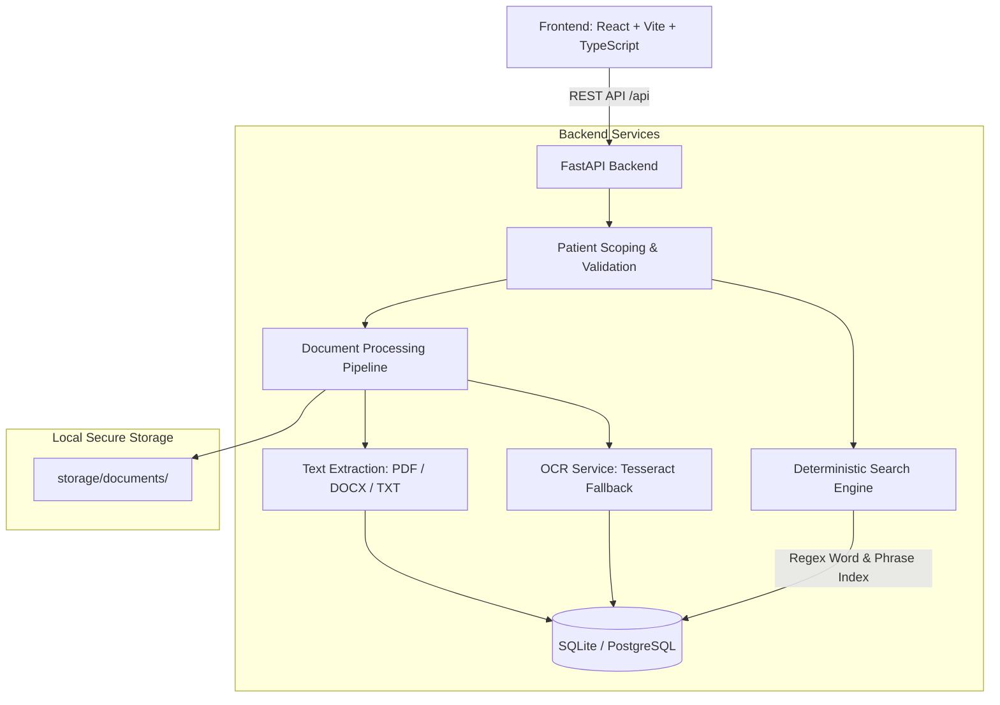

# Patient Medical Document Search System

A standalone, deterministic web application module designed for hospital staff, doctors, and interns to search the text contents of multiple medical reports belonging to a single patient.

This application is built as an independent, testable module that will eventually be integrated into a larger Healthcare Operating System (Healthcare OS) for hospitals.

---

## 1. Project Overview

In hospital workflows, a patient often accumulates dozens of medical records: laboratory blood panels, outpatient consultation notes, radiology reports, allergy assessments, and hospital discharge summaries.

When a healthcare provider needs to find whether or where a specific term appears across all records belonging to a patient (e.g., verifying whether `allergies`, `penicillin`, or `blood pressure` was noted in any past report), opening and manually reading each document is time-consuming and error-prone.

The **Patient Medical Document Search System** provides a centralized, deterministic document search engine. A user selects a patient, enters a search query, and immediately views every occurrence of that term across all of the patient's supported medical reports, with:
- The exact source document name
- The exact page number (for PDFs) or paragraph/section location (for DOCX/TXT)
- The surrounding text excerpt for clinical context
- Highlighting of the matched word or phrase
- Direct document viewing and location tracing

---

## 2. Problem Being Solved

### Core Purpose: Deterministic Document Search, NOT an AI Diagnostic System
This system is an **evidence-based text search engine**, not a medical AI assistant.
- It does **not** interpret, diagnose, recommend treatment, or summarize.
- It treats all textual occurrences neutrally. For example, all of the following are returned as valid matches when searching for `allergies`:
  - *"The patient has a history of allergies."*
  - *"No known allergies."*
  - *"The allergy test returned negative."*
  - *"Allergies were investigated during the previous consultation."*
- If a term does not appear in a patient's records, it displays:
  > *"No matches found in this patient's medical records."*
  with a clinical note explaining that this only reflects absence of the text in the searched documents, not a medical condition.

---

## 3. Main Features

1. **Patient Directory & Selection**:
   - Unique patient identifiers (`PAT-1001`, `PAT-1002`, etc.)
   - Associated report count and registration metadata
   - Ability to create synthetic patients directly from the UI

2. **Strict Patient Data Isolation**:
   - Searches are strictly scoped at the backend/database level to the selected patient.
   - Searches never leak or query documents belonging to other patients.

3. **Multi-Document Ingestion & Parsing**:
   - Supports **PDF** (page-by-page extraction), **DOCX** (paragraph and table extraction), and **TXT** files.
   - Multi-file drag-and-drop uploads with size limit enforcement (25 MB default).
   - Duplicate upload prevention via SHA-256 content hashing.

4. **Multi-Occurrence & Multi-Document Search Completeness**:
   - Does not stop at the first match or truncate occurrences without pagination.
   - If a word appears 5 times in one document and 3 times in another, all 8 occurrences are captured and counted.

5. **Exact vs. Flexible Search Modes**:
   - **Exact Mode**: Case-insensitive whole-word and phrase matching with word boundary protection (e.g., searching `cat` does not match `category`).
   - **Flexible Mode**: Matches common singular and plural word forms (e.g., searching `allergies` matches both `allergies` and `allergy`).

6. **Source Traceability & Document Preview**:
   - View PDF documents inline with `#page={page}` navigation.
   - View extracted, indexed text segments for DOCX and TXT files.
   - One-click file download / open in new tab.

7. **OCR Capability & Honest Reporting**:
   - Built-in integration for Tesseract OCR to extract text from scanned PDFs.
   - Detects whether OCR is installed and truthfully reports engine status in the UI, avoiding false claims.

---

## 4. Technology Stack

- **Frontend**: React 18, TypeScript, Vite, Lucide Icons, Plain CSS Clinical Design System.
- **Backend**: Python 3.10+ (tested on Python 3.15), FastAPI, Pydantic, SQLAlchemy 2.
- **Document Processing**: `pypdf`, `python-docx`, standard Python text processing, optional `pytesseract` / `pillow`.
- **Database**: SQLite (isolated local file `storage/patient_search.db`), designed for clean migration to PostgreSQL.

---

## 5. Architecture Overview



---

## 6. Project Directory Structure

```
ClinicOS/
├── backend/
│   ├── app/
│   │   ├── api/
│   │   │   ├── endpoints/
│   │   │   │   ├── patients.py      # Patient listing, creation, and search
│   │   │   │   ├── documents.py     # Document metadata, content stream, preview
│   │   │   │   └── system.py        # System diagnostic status & demo reset
│   │   │   └── api.py               # Combined API router
│   │   ├── core/
│   │   │   └── config.py            # Settings, paths, size limits, OCR config
│   │   ├── database/
│   │   │   └── session.py           # SQLAlchemy engine & session factory
│   │   ├── models/
│   │   │   └── models.py            # Patient, Document, DocumentSegment models
│   │   ├── schemas/
│   │   │   └── schemas.py           # Pydantic request & response schemas
│   │   ├── services/
│   │   │   ├── document_processing.py # Storage, hash checking, status tracking
│   │   │   ├── text_extraction.py     # PDF, DOCX, TXT parsers
│   │   │   ├── ocr_service.py         # Tesseract detection & OCR handling
│   │   │   └── search_service.py      # Scoped regex matching & context extraction
│   │   └── main.py                  # FastAPI application entrypoint
│   ├── tests/
│   │   └── test_medical_search.py   # Automated test suite (18+ scenarios)
│   ├── seed_demo_data.py            # Synthetic demonstration generator & seeder
│   ├── synthetic_data_generator.py  # Pure Python PDF, DOCX, TXT generator
│   └── requirements.txt             # Backend dependencies
├── frontend/
│   ├── src/
│   │   ├── components/
│   │   │   ├── Navbar.tsx
│   │   │   ├── PatientDashboard.tsx
│   │   │   ├── PatientWorkspace.tsx
│   │   │   ├── SearchResults.tsx
│   │   │   ├── DocumentPreviewModal.tsx
│   │   │   └── CreatePatientModal.tsx
│   │   ├── services/
│   │   │   └── api.ts               # Typed API client
│   │   ├── styles/
│   │   │   └── app.css              # Clinical design system styling
│   │   ├── types/
│   │   │   └── index.ts             # TypeScript interfaces
│   │   ├── App.tsx                  # Root component
│   │   └── main.tsx                 # React entrypoint
│   ├── package.json
│   ├── tsconfig.json
│   └── vite.config.ts               # Proxy configuration to port 8000
├── storage/
│   └── documents/                   # Uploaded medical records
├── sample_data/
│   └── README.md                    # Synthetic sample documentation
├── run_backend.bat                  # Windows backend runner
├── run_frontend.bat                 # Windows frontend runner
├── run_app.bat                      # Windows one-click dual launcher
├── run_tests.bat                    # Automated test runner
├── seed_data.bat                    # Demonstration seeder runner
├── .env.example
├── .gitignore
└── README.md
```

---

## 7. Prerequisites

- **Python**: Version 3.10 or higher (Python 3.15 supported).
- **Node.js**: Version 18 or higher (v24.x tested) and `npm`.
- **Operating System**: Windows (tested), macOS, or Linux.
- **Tesseract OCR (Optional)**: For scanned image PDFs.

---

## 8. Installation Instructions for Windows

### Step 1: Clone or navigate to the repository
```powershell
cd c:\Users\Aarush\OneDrive\Desktop\ClinicOS
```

### Step 2: Backend Setup
Create and activate a virtual environment:
```powershell
python -m venv .venv
.\.venv\Scripts\activate
```
Install backend dependencies:
```powershell
pip install -r backend/requirements.txt
```

### Step 3: Frontend Setup
In the `frontend` folder:
```powershell
npm --prefix frontend install
```

### Step 4: Seed Synthetic Demonstration Data
Run the seeding script to create synthetic demonstration patients and sample PDF, DOCX, and TXT files:
```powershell
.\.venv\Scripts\python.exe backend/seed_demo_data.py
```
*(Or simply double-click `seed_data.bat`)*

---

## 9. OCR Setup (Optional)

Direct text extraction from standard PDFs, DOCX, and TXT files **works out of the box without OCR**.

To enable OCR for scanned image-only PDFs:
1. Install Tesseract OCR for Windows:
   - Download the installer from: [UB-Mannheim Tesseract OCR](https://github.com/UB-Mannheim/tesseract/wiki)
   - Or install via Windows Package Manager:
     ```powershell
     winget install UB-Mannheim.TesseractOCR
     ```
2. By default, the application checks standard Windows locations:
   `C:\Program Files\Tesseract-OCR\tesseract.exe`.
3. If installed in a custom location, add to your `.env`:
   ```env
   TESSERACT_CMD=C:\Path\To\tesseract.exe
   ```
4. If Tesseract is not installed, the application truthfully displays `OCR: Offline (Direct Extraction Only)` in the navigation bar and uses direct extraction without failing.

---

## 10. How to Run the Application

### Option A: One-Click Windows Launcher
Double-click `run_app.bat` or run:
```powershell
.\run_app.bat
```
This automatically starts both the backend API and frontend dev server in separate console windows.

### Option B: Manual Execution
**Terminal 1 (Backend API):**
```powershell
.\run_backend.bat
```
Server runs on: `http://127.0.0.1:8000`
Swagger API Documentation: `http://127.0.0.1:8000/docs`

**Terminal 2 (Frontend):**
```powershell
.\run_frontend.bat
```
Application UI opens on: `http://localhost:5173`

---

## 11. How to Use the System

1. **Open Dashboard**:
   Navigate to `http://localhost:5173`. You will see the Patient Directory with demonstration patients (`PAT-1001`, `PAT-1002`, `PAT-1003`).

2. **Select a Patient**:
   Click **"Open Workspace"** on `PAT-1001` (Demonstration Patient One).

3. **Search for Medical Terms**:
   In the prominent search bar, type a term such as `allergies` and press **Enter** (or click **Search**).
   - Instant results appear across all documents for `PAT-1001` (e.g., `PAT1001_Medical_History.txt`, `PAT1001_Allergy_Assessment.pdf`, `PAT1001_Discharge_Summary.docx`).
   - Notice the exact page locations (`Page 1`, `Page 2`, `Paragraph 2`).
   - Notice the highlighted snippets with clinical surrounding context.

4. **Verify Patient Isolation**:
   - Go back to Patients and select `PAT-1002` (Demonstration Patient Two).
   - Search for `allergies`.
   - The system displays: *"No matches found in this patient's medical records."*
   - Now search for `blood pressure` or `diabetes`. The results immediately display matches from `PAT-1002`'s cardiovascular notes and lab report.

5. **Upload New Documents**:
   - Switch to the **Documents** tab in the patient workspace.
   - Drag and drop or browse for any `.pdf`, `.docx`, or `.txt` file.
   - The file is validated, stored safely, parsed, and immediately indexed for search.

6. **Preview Documents**:
   - Click the **Eye icon** or **"View Document"** on any search result.
   - For PDFs, the modal loads the document navigated to the matching page.
   - For DOCX and TXT, click the **"Indexed Segments"** tab to view all extracted paragraphs with the matching paragraph highlighted.

---

## 12. Search Matching Rules

1. **Case-Insensitive**:
   - `allergies`, `ALLERGIES`, and `Allergies` return identical matches.
2. **Whole-Word Boundary Protection**:
   - Searching for `cat` will **not** match `category` or `concatenation`.
   - Protects against noisy substring false positives.
3. **Phrase Searching**:
   - Multi-word phrases like `blood pressure` or `routine surgical consultation` match with whitespace tolerance.
4. **Flexible Mode (Singular / Plural)**:
   - When enabled, searching `allergies` matches both `allergies` and `allergy`.
   - Searching `infection` matches both `infection` and `infections`.
   - Supports irregular medical forms (e.g. `analysis` / `analyses`, `bronchus` / `bronchi`).
5. **Special Characters & Punctuation**:
   - Handles hyphenated medical codes (e.g., `COVID-19`), brackets, angles (`<HbA1c>`), and percentages without regex injection errors.

---

## 13. Supported File Formats

| Format | Extension | Extraction Strategy | Location Granularity |
| :--- | :--- | :--- | :--- |
| **PDF Documents** | `.pdf` | Page-by-page extraction (`pypdf` / PyMuPDF) + OCR for scanned pages | 1-indexed Page Numbers (`Page 1`, `Page 2`, etc.) |
| **Word Documents** | `.docx` | Paragraph & table text extraction (`python-docx`) | Paragraph / Section index (`Paragraph 1`, etc.) |
| **Plain Text** | `.txt` | Multi-encoding reading (UTF-8, Latin-1) + block chunking | Paragraph / Section index |

---

## 14. API Endpoints Reference

FastAPI automatically serves interactive OpenAPI documentation at `http://127.0.0.1:8000/docs`.

### Patient Endpoints
- `GET /api/patients`: List all patients with associated document counts.
- `POST /api/patients`: Create a new patient record (`patient_code`, `display_name`).
- `GET /api/patients/{patient_id}`: Retrieve a specific patient.
- `DELETE /api/patients/{patient_id}`: Delete patient and cascade delete all documents/files.
- `GET /api/patients/{patient_id}/documents`: List documents belonging to patient.
- `POST /api/patients/{patient_id}/documents`: Multipart file upload for patient.
- `GET /api/patients/{patient_id}/search?q={query}&mode={exact|flexible}&page={page}`: Execute patient-scoped search.

### Document Endpoints
- `GET /api/documents/{document_id}`: Retrieve document metadata.
- `GET /api/documents/{document_id}/content`: Stream original file for inline preview or download.
- `GET /api/documents/{document_id}/segments`: Retrieve extracted text segments and locations.
- `DELETE /api/documents/{document_id}`: Delete document, wipe searchable index, and delete disk file.
- `POST /api/documents/{document_id}/reprocess`: Re-extract text and rebuild search segments.

### System Endpoints
- `GET /api/system/status`: Check OCR availability, storage paths, and quotas.
- `POST /api/system/seed-demo`: Reset and reseed demonstration patients and files.

---

## 15. Testing Instructions

The project includes an extensive automated test suite covering all 18 scenarios requested in the specification.

To execute tests:
```powershell
.\.venv\Scripts\python.exe -m pytest backend/tests -v
```
*(Or double-click `run_tests.bat`)*

### Tested Scenarios:
1. `test_01_basic_word_search`: Basic single word search.
2. `test_02_case_insensitive_search`: Verifies UPPER, lower, and MiXeD case equivalence.
3. `test_03_no_matches_found`: Absence of search term returns 0 results cleanly.
4. `test_04_multiple_occurrences_single_doc`: 5 occurrences in 1 document returns 5 results.
5. `test_05_multiple_documents_search`: 5 documents, 3 containing term returns matches across all 3.
6. `test_06_patient_isolation`: Strict scoping prevents leakage between Patient A and Patient B.
7. `test_07_pdf_page_identification`: Correct multi-page PDF page attribution (Page 2).
8. `test_08_docx_extraction`: DOCX paragraph extraction and searchability.
9. `test_09_txt_extraction_multiple_terms`: Multi-section TXT extraction.
10. `test_10_phrase_search`: Multi-word phrase search (`blood pressure`).
11. `test_11_singular_plural_matching`: Flexible mode matching `allergy` against `allergies`.
12. `test_12_repeated_searches_clean`: Successive queries replace state without stale results.
13. `test_13_file_deletion_cleanup`: Deleting document removes indexed content from search.
14. `test_14_corrupted_file_handling`: Corrupted uploads marked failed with visible notice.
15. `test_15_ocr_detection`: Accurate, truthful OCR engine availability check.
16. `test_16_special_characters_and_safety`: Handles `COVID-19`, `<HbA1c>`, quotes safely.
17. `test_17_pagination`: 25 occurrences paginated cleanly across multiple pages.
18. `test_18_prevent_false_substring_matches`: Verifies `cat` does not match `category`.

---

## 16. Future Integration into Healthcare OS

This standalone module is designed for drop-in integration into a hospital-wide Healthcare Operating System.

### Integration Architecture:
```
[Healthcare OS Core]
         │
         ├── 1. Context: User selects patient in Hospital EHR
         │      (Passes Hospital Patient UUID)
         │
         ├── 2. Scoped Request: Healthcare OS invokes Search API
         │      GET /api/patients/{hospital_patient_id}/search?q=allergies
         │
         ├── 3. Structured Response: Search module returns JSON occurrences
         │      (Document ID, page, context excerpt, match offsets)
         │
         └── 4. Native Rendering: Healthcare OS renders matches in EHR timeline
```

### Components Directly Reusable During Integration:
1. `backend/app/services/search_service.py`: Completely framework-agnostic search logic.
2. `backend/app/services/text_extraction.py`: Independent document parsers for PDF, DOCX, TXT.
3. `backend/app/services/document_processing.py`: Content hashing and disk storage abstraction.
4. `backend/app/schemas/schemas.py`: Standardized Pydantic schemas.

### Necessary Changes for Production Hospital Deployment:
- **Database Migration**: Switch `DATABASE_URL` in `.env` from SQLite to PostgreSQL (`postgresql+psycopg2://...`).
- **Patient Identifier Mapping**: Replace prototype internal patient IDs with the Healthcare OS's master patient index (MPI) or FHIR Patient Resource IDs.
- **Authentication & RBAC**: Connect hospital OAuth2 / OpenID Connect (e.g. Keycloak / Active Directory) to protect patient records based on clinician roles.
- **Audit Logging**: Add HIPAA-compliant audit logs recording which clinician searched which patient's records and when.
- **Encrypted Storage**: Enable AES-256 encryption at rest for document files in storage and TLS in transit.

---

## 17. Security and Data Privacy Limitations

- **Local Demonstration Notice**: This prototype is built for local development, evaluation, and standalone testing. It must **not** be exposed to an untrusted public network or used with real unprotected Protected Health Information (PHI) without hospital-grade authentication and encryption.
- **Synthetic Data Guarantee**: All sample reports generated by `backend/seed_demo_data.py` are strictly synthetic and fictional.
- **Zero Cloud AI Dependency**: No documents or queries are transmitted to third-party AI APIs, cloud LLMs, or external services. All processing is 100% deterministic and local.
